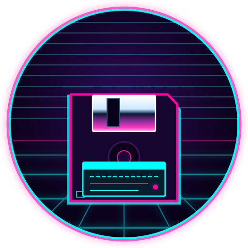
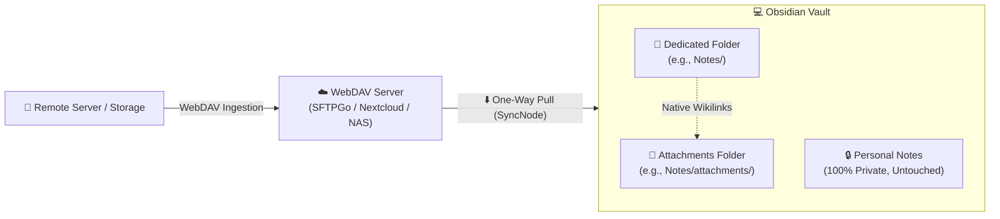

# SyncNode for Obsidian

<p align="center">
  
</p>

<p align="center">
  <b>One-way selective WebDAV ingestion plugin for Obsidian.</b><br>
  <i>Securely download notes, folders, and media from your server into a dedicated vault folder without uploading local files.</i>
</p>

<p align="center">
  <a href="https://github.com/EugeneDwarf/SyncNode/releases"></a>
  <a href="https://obsidian.md"></a>
  <a href="LICENSE"></a>
  
  
</p>

---

[English](#english) | [Русский](#русский)

---

<a name="english"></a>
## English

### 💡 Why SyncNode?

Most sync tools for Obsidian (like Remotely Save, LiveSync, or Git) perform **full bidirectional synchronization**. While great for replicating your entire vault, two-way sync presents serious risks for automated ingestion pipelines:

1. **Risk of Data Leakage:** Two-way sync can inadvertently upload your entire private personal vault back to your ingestion server.
2. **Conflict Forks & Deletions:** If you delete or archive ingested notes on your device, bidirectional sync may propagate deletions back to the server, breaking files stored on your remote server.
3. **Vault Clutter:** Remote sync sources often dump files directly into your vault root or spread media everywhere.

**SyncNode solves this with a strictly one-way, isolated architecture:**
* It **only pulls** from your WebDAV server into a **single dedicated folder** (`Notes/`).
* It **never uploads** or touches any other folder in your vault.
* It routes media files into a centralized attachments directory (`Notes/attachments/`) while keeping native `![[photo.jpg]]` Obsidian links working seamlessly.



---

### ✨ Features

- **🪄 Interactive Onboarding Wizard:** 4-step guided setup wizard that automatically opens on first install or via command/settings. Includes server presets (SFTPGo, Nextcloud, Synology NAS), URL auto-sanitization, live diagnostics, and instant initial sync.
- **⚡ 5-Stream Concurrent Worker Pool:** Fast multi-threaded downloader processing up to 5 files simultaneously with per-file error isolation, accelerating initial downloads by 4–5x.
- **📝 Ingestion Template Engine:** Formats newly downloaded Markdown notes using custom templates with Callouts, tasks, and dynamic variables.
- **🌐 Bilingual Interface (EN / RU):** Switch between English (default) and Russian directly in settings with instant interface re-rendering.
- **🛡️ Strictly One-Way (Pull-Only):** Zero upload logic (`PUT`, `POST`, or remote deletion). Your private vault notes never leave your device.
- **📂 Isolated Vault Folder:** All remote files and subdirectories are saved strictly inside a designated vault directory (default: `Notes/`).
- **🖼️ Dedicated Attachments Folder:** Automatically routes downloaded images, audio, video, and documents into a separate folder (default: `Notes/attachments/`), keeping note directories clean while native Obsidian wikilinks `![[photo.jpg]]` work out-of-the-box.
- **🩺 Connection Diagnostics:** Built-in **"Test Connection"** button verifies server reachability, SSL certificates, and authentication credentials, reporting exact diagnostic feedback (HTTP `200/207`, `401`, `403`, `404`).
- **📲 1-Click Configuration Transfer (Token Setup):** Export an encrypted configuration token (`syncnode://...`) on your desktop and import it on your phone or tablet in one click without manually typing URLs, usernames, or complex passwords.
- **⏱️ Background Auto-Sync & Ribbon Shortcut:** Run sync manually via the ribbon icon or command palette (`Ctrl + P`), or set an automatic background sync interval.
- **📱 Fully Cross-Platform:** Works seamlessly on Windows, macOS, Linux, iOS, and Android.

---

### 📝 Ingestion Template Engine

When enabled, newly ingested notes (`.md`) are automatically wrapped into your preferred template structure. Existing YAML frontmatter from incoming notes is cleanly merged without syntax corruption.

#### Available Variables:

| Variable | Description | Example |
| :--- | :--- | :--- |
| `{{title}}` | Note title (filename without `.md`) | `My Project Note` |
| `{{date}}` | Current date on your device | `2026-10-30` |
| `{{time}}` | Current time on your device | `15:30` |
| `{{mtime_date}}` | File modification date from server | `2026-10-30` |
| `{{mtime_time}}` | File modification time from server | `14:22` |
| `{{source_url}}` | Auto-detected URL from YAML or body | `https://example.com/article` |
| `{{content}}` | Body of the incoming note | *(Full note text)* |

#### Default Template Example:
```markdown
---
created: {{date}} {{time}}
status: inbox
---
> [!info] {{title}}
> Created: [[{{date}}]] {{time}}

- [ ] Process note

{{content}}
```

---

### 🚀 Installation

#### Option 1: Via BRAT (Recommended for Mobile & Early Updates)

1. In Obsidian, open **Settings** → **Community plugins**.
2. Search for and install **BRAT** (Beta Reviewers Auto-update Tester).
3. Open **BRAT settings** → click **Add Beta plugin**.
4. Enter the GitHub repository URL: `https://github.com/EugeneDwarf/SyncNode`.
5. Click **Add Plugin**. BRAT will download, install, and automatically manage updates.

#### Option 2: Manual Installation (Desktop)

1. Download `manifest.json` and `main.js` from the [Latest Release](https://github.com/EugeneDwarf/SyncNode/releases).
2. In your Obsidian vault directory, navigate to `<vault>/.obsidian/plugins/`.
3. Create a folder named `syncnode`.
4. Copy `manifest.json` and `main.js` into `<vault>/.obsidian/plugins/syncnode/`.
5. Open Obsidian, go to **Settings** → **Community plugins**, reload plugins, and enable **SyncNode**.

---

### ⚙️ Configuration Guide

Open **Settings** → **SyncNode**:

| Setting | Description | Default |
| :--- | :--- | :--- |
| **Language** | Choose interface language (`English` or `Русский`). | `English` |
| **WebDAV URL** | Full HTTPS endpoint URL with trailing slash (e.g. `https://hub.example.com/webdav/`). | `""` |
| **Username (WebDAV)** | WebDAV account username. | `""` |
| **Password (WebDAV)** | WebDAV account password. | `""` |
| **Connection Test** | Click **"Test Connection"** to verify reachability and credentials. | — |
| **Target Vault Folder** | Folder in your vault where all remote files are saved. | `Notes` |
| **Dedicated Attachments** | Toggle on to redirect media/attachments into a central folder. | `true` |
| **Attachments Folder Path** | Subfolder where media files will be saved. | `Notes/attachments` |
| **Auto-Sync Interval** | Frequency of background sync in minutes (`0` = manual only). | `5` |
| **Sync on Startup** | Automatically checks for new notes 3 seconds after Obsidian starts. | `true` |
| **Notifications** | Display Obsidian notices during checks and downloads. | `true` |
| **Ingestion Template** | Format new notes using custom Markdown templates with callouts & variables. | `false` |
| **1-Click Setup Transfer** | Click **"Copy Token"** on PC to export settings; paste into **"Import"** on mobile. | — |

---

### 🖥️ Compatible WebDAV Servers

SyncNode works with any standard WebDAV (RFC 4918) server, including:

* **SFTPGo** (Recommended for lightweight Docker setups)
* **Nextcloud / ownCloud** (`https://cloud.example.com/remote.php/dav/files/USER/`)
* **Synology NAS** (`https://nas.example.com:5006/home/`)
* **Apache / Nginx WebDAV modules**
* **rclone serve webdav**

---

### 🛠️ Development & Building from Source

```bash
# Clone repository
git clone https://github.com/EugeneDwarf/SyncNode.git
cd SyncNode

# Install dependencies
npm install

# Build production bundle (main.js)
npm run build

# Start live development watch mode
npm run dev
```

---

### 🔒 Security & Privacy

* **Strictly Pull-Only:** No code exists in this plugin to perform `PUT`, `POST`, or `DELETE` requests against your WebDAV server.
* **Local Storage:** All credentials and settings are stored locally inside your vault at `<vault>/.obsidian/plugins/syncnode/data.json`.
* **Zero Telemetry:** No analytics, tracking, or calls to third-party servers. All communication happens strictly between your device and your configured WebDAV endpoint.

---

### 📄 License

Distributed under the [MIT License](LICENSE).

---

<a name="русский"></a>
## Русский

### 💡 Зачем нужен SyncNode?

Большинство существующих плагинов синхронизации для Obsidian (такие как Remotely Save, LiveSync или Git) выполняют **полную двустороннюю синхронизацию**. Это отлично подходит для зеркалирования всего хранилища, но несет критические риски при автоматическом сборе заметок:

1. **Риск утечки личных данных:** Двусторонняя синхронизация может непреднамеренно выгрузить все ваше личное хранилище на публичный или серверный WebDAV-накопитель.
2. **Конфликты и случайные удаления:** Если вы удаляете или перемещаете обработанную заметку на телефоне или компьютере, двусторонний плагин может удалить её с сервера, затронув файлы на удалённом хранилище.
3. **Засорение хранилища:** Автоматические источники часто сгружают файлы в корень или разбрасывают картинки по разным папкам.

**SyncNode решает эту проблему благодаря изолированной односторонней архитектуре:**
* Плагин **только скачивает** данные с WebDAV-сервера в **одну указанную папку** (`Notes/`).
* Он **никогда не выгружает** данные на сервер и не трогает остальные файлы вашего хранилища.
* Автоматически складывает медиафайлы в единую папку вложений (`Notes/attachments/`), при этом стандартные ссылки `![[photo.jpg]]` продолжают корректно открываться.

---

### ✨ Возможности

- **🪄 Интерактивный мастер настройки (Onboarding Wizard):** Пошаговый 4-шаговый помощник, который автоматически открывается при первой установке. Включает готовые пресеты (SFTPGo, Nextcloud, Synology), автодополнение URL, встроенную диагностику связи и запуск первой синхронизации.
- **⚡ Пул параллельной загрузки (5 потоков):** Высокоскоростное параллельное скачивание файлов через очередь конкурентности с изоляцией сетевых сбоев (ускорение в 4–5 раз).
- **📝 Шаблонизатор входящих заметок:** Автоматическое оформление новых Markdown-заметок по настраиваемому шаблону с поддержкой переменных, Callout-блоков, чеклистов и безопасного слияния метаданных YAML Frontmatter.
- **🌐 Двуязычный интерфейс (EN / RU):** Переключение языка (английский по умолчанию, русский) прямо в настройках с мгновенным обновлением интерфейса.
- **🛡️ Строго односторонняя загрузка (Pull-Only):** В плагине принципиально **отсутствует код выгрузки** (`PUT`, `POST` или удаление на сервере). Ваши личные файлы никогда не покинут устройство.
- **📂 Изоляция в целевой папке:** Все файлы скачиваются строго внутрь выбранного каталога (по умолчанию `Notes/`).
- **🖼️ Отдельная папка для вложений:** Автоматическое перенаправление изображений, видео, аудио и документов в папку вложений (по умолчанию `Notes/attachments/`), предотвращая захламление текстовых заметок.
- **🩺 Диагностика подключения:** Кнопка **«Проверить подключение»** моментально тестирует сетевую доступность, SSL-сертификат и авторизацию с выводом точных статусов (HTTP `200/207`, `401`, `403`, `404`).
- **📲 Быстрый перенос настроек в 1 клик (Токен):** Экспорт зашифрованного токена (`syncnode://...`) на ПК и импорт на смартфоне или планшете без ручного ввода URL и паролей.
- **⏱️ Фоновая автосинхронизация и кнопка на панели:** Удобная иконка на панели Obsidian, горячая клавиша в палитре (`Ctrl + P`) и таймер периодической проверки.
- **📱 Кроссплатформенность:** Поддерживает Windows, macOS, Linux, Android и iOS.

---

### 📝 Шаблонизатор входящих заметок

При включении шаблонизатора каждая новая заметка оформляется по заданному шаблону. Если входящий файл уже содержит YAML Frontmatter, метаданные не ломаются и аккуратно объединяются с шапкой.

#### Доступные переменные:

| Переменная | Описание | Пример |
| :--- | :--- | :--- |
| `{{title}}` | Название заметки (имя файла без `.md`) | `Рабочая заметка` |
| `{{date}}` | Текущая дата на устройстве | `2026-10-30` |
| `{{time}}` | Текущее время на устройстве | `15:30` |
| `{{mtime_date}}` | Дата изменения файла на сервере | `2026-10-30` |
| `{{mtime_time}}` | Время изменения файла на сервере | `14:22` |
| `{{source_url}}` | Автоизвлеченная ссылка из текста/YAML | `https://habr.com/post/123/` |
| `{{content}}` | Исходный текст входящей заметки | *(Текст сообщения)* |

#### Пример шаблона по умолчанию:
```markdown
---
created: {{date}} {{time}}
status: inbox
---
> [!info] {{title}}
> Создано: [[{{date}}]] в {{time}}

- [ ] Разобрать заметку

{{content}}
```

---

### 🚀 Установка

#### Вариант 1: Через плагин BRAT (Рекомендуется для телефонов и обновлений)

1. В Obsidian перейдите в **Настройки** → **Сторонние плагины** (Community plugins).
2. Найдите и установите плагин **BRAT** (Beta Reviewers Auto-update Tester).
3. В настройках **BRAT** нажмите **Add Beta plugin**.
4. Вставьте адрес репозитория: `https://github.com/EugeneDwarf/SyncNode`.
5. Нажмите **Add Plugin**. BRAT скачает плагин и обеспечит его автоматические обновления.

#### Вариант 2: Ручная установка (На компьютере)

1. Скачайте `manifest.json` и `main.js` из [раздела релизов](https://github.com/EugeneDwarf/SyncNode/releases).
2. В каталоге вашего хранилища откройте `<Хранилище>/.obsidian/plugins/`.
3. Создайте папку `syncnode`.
4. Поместите файлы `manifest.json` и `main.js` внутрь папки `syncnode`.
5. В Obsidian откройте **Настройки** → **Сторонние плагины**, нажмите **Перезагрузить** и включите **SyncNode**.

---

### ⚙️ Руководство по настройке

Откройте **Настройки** → раздел **SyncNode**:

* **Язык (Language):** Выбор языка интерфейса (`English` или `Русский`).
* **WebDAV URL:** Полный HTTPS-адрес со слэшем на конце (например, `https://hub.example.com/webdav/`).
* **Логин (WebDAV):** Имя пользователя WebDAV.
* **Пароль (WebDAV):** Пароль пользователя WebDAV.
* **Проверка подключения:** Кнопка для тестирования соединения и валидации данных.
* **Целевая папка в Obsidian:** Папка для скачиваемых заметок (по умолчанию `Notes`).
* **Отдельная папка для вложений:** Включите тумблер для изоляции медиафайлов.
* **Путь к папке вложений:** Папка для медиафайлов (по умолчанию `Notes/attachments`).
* **Интервал автосинхронизации:** Частота проверки в минутах (`0` — только вручную).
* **Синхронизация при старте:** Проверка новых заметок через 3 секунды после запуска Obsidian.
* **Уведомления:** Отображение всплывающих оповещений Obsidian.
* **Шаблонизатор заметок:** Включение автооформления и редактор шаблона с кнопкой сброса по умолчанию.
* **Быстрый перенос настроек:** Кнопка «Скопировать токен» на компьютере и «Применить» на смартфоне.

---

### 🛠️ Разработка и сборка из исходников

```bash
# Клонирование репозитория
git clone https://github.com/EugeneDwarf/SyncNode.git
cd SyncNode

# Установка зависимостей сборки
npm install

# Релизная компиляция бандла (main.js)
npm run build

# Запуск в режиме живой разработки с автопересборкой
npm run dev
```

---

### 🔒 Безопасность и конфиденциальность

* **Только входящая загрузка:** В коде плагина отсутствуют методы отправки файлов на сервер.
* **Локальное хранение:** Все настройки сохраняются исключительно локально внутри вашего хранилища в `<хранилище>/.obsidian/plugins/syncnode/data.json`.
* **Никакой телеметрии:** Плагин не передает никаких аналитических данных третьим лицам.

---

### 📄 Лицензия

Распространяется под свободной лицензией [MIT](LICENSE).
